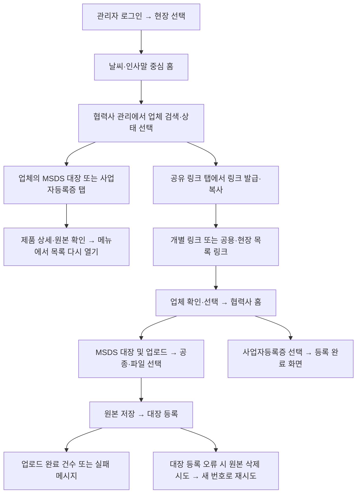
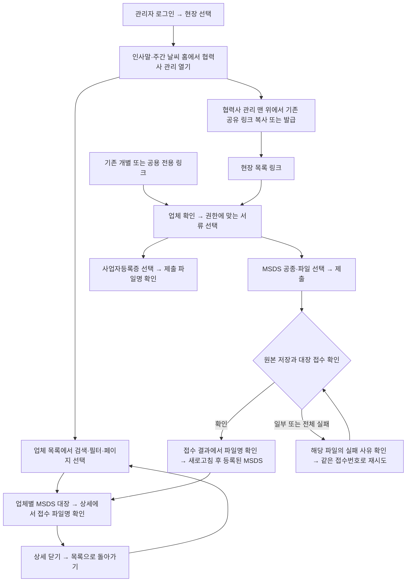

# 현장 보건관리 업무 점검

관리자 홈과 공유 링크의 위치는 1차 점검 후 변경했다. 현재 홈에는 인사말·날씨·업무 바로가기가 있고, 협력사 관리에 들어가면 공유 링크가 맨 위에 보인다. 아래 전후 캡처와 검증표는 1차 점검 당시의 기록이다.

후속 변경 화면은 가상 현장에서 촬영했다. [복원한 관리자 홈](restored-home-1366.png) · [공유 링크 위치](share-first-desktop.png) · [모바일 기상특보 예시](advisories-390.png)

## 진입 경로와 권한

저장소는 Vite 다중 페이지 앱이다. 관리자 메뉴는 주소 경로를 바꾸지 않고 같은 페이지 안에서 전환된다. 운영 주소는 저장소에 기록된 `gshealthk.vercel.app`를 기준으로 파악했다. 공개 로그인 화면에 대한 외부 접속은 이 환경의 네트워크에서 차단됐다.

| 진입 경로 | 사용자와 업무 | 연결 |
|---|---|---|
| `/`, `/index.html` | 보건관리자·현장 직원이 로그인해 현장을 선택한다. 현장 담당자·소유자가 팀원을 관리하고 시스템 관리자가 별도 콘솔을 사용한다. | Supabase Auth, 현장 멤버십, 현장 ID로 범위를 제한한 PostgREST 조회·저장, Realtime 알림 |
| `/#team-invite=…` | 초대받은 직원이 현장 참여 절차로 진입한다. | 팀 초대·가입·승인 RPC |
| `/upload.html?token=…` | 개별 업체의 협력사 담당자가 로그인 없이 해당 업체 업무를 연다. | `get_contractor_portal`, `get_contractor_workspace` |
| `/upload.html?ptoken=…` | 공용 링크에서 업체를 선택하거나 등록한다. 제출 가능한 서류는 링크 설정을 따른다. | 위 RPC, `register_public_contractor` |
| `/contractors.html?dtoken=…` | 현장 협력사 목록에서 업체별 MSDS·등록증·연락처를 확인한다. | `get_contractor_directory`, `save_directory_contractor` |
| `/upload.html?dtoken=…&contractor_id=…` | 현장 목록에서 선택한 업체의 전용 업무를 연다. | 같은 현장·업체 범위의 포털 RPC |
| 전용 링크의 `panel` 매개변수 | 대시보드, 연락처, MSDS 대장·제출, 경고표지, 등록증, 위치도, 근로자 정보변경 신청, 관리책임자 표지로 바로 들어간다. | 최초 링크와 패널별 허용 범위 확인 |
| `/pmx-import.html#snapshot=…` | PMX에서 전달받은 현장·협력사 정보를 검토하는 진입점이다. | 스냅샷 검증, 세션 전달, 관리자 화면의 확인·반영 절차 |
| `/docs/contractor-admin.html`, `/docs/contractor-workspace.html`, `/docs/uploads.html` | 관리자·협력사용 기존 이용 안내 | 정적 HTML |

관리자 화면에는 홈, 공지, 요청 현황, 협력사와 공유 링크, MSDS, 경고표지, 현장 위치도, 건강진단, 취약근로자, 혈압, 작업환경측정, 날씨, 바인더, 관리책임자 표지, 사진, 인원, 자료실, 건의, 설정, 시스템 관리가 있다. 기존 `upload-link` 메뉴 호출은 협력사 관리의 맨 위 공유 링크로 이어진다.

접수 원본은 Storage의 `msds-pdfs`, 대장 행은 `msds_records`에 저장한다. 등록증은 `business-licenses`와 `register_contractor_license`를 사용한다. 협력사 재제출은 `complete_public_reupload`가 대장 버전·재요청 상태·알림을 갱신한다. 관리자 화면은 `contractors`, `work_types`, `business_licenses`, `msds_records`를 현장별로 조회한다. Edge Functions에는 원본 열람, 문서 분석, AI 설정, 현장 날씨, 법령·공단 검색, 위치도 사진, 시스템 관리가 있다. 연결 주소와 공개 클라이언트 키는 기존 Vite 환경변수로 주입한다.

## 수정 전 업무 흐름



## 개선 후 업무 흐름



## 화면 비교

모든 캡처는 로컬 브라우저에서 가상 업체와 파일로 촬영했다. 관리자 홈 비교에는 저장소의 개발 미리보기를, 접수 결과와 관리자 업체 목록에는 두 역할의 통합 시나리오를 사용했다.

| 화면 크기 | 관리자 홈 | 협력사 MSDS 제출 |
|---|---|---|
| 390 × 844 | [전](before-home-390.png) · [후](after-home-390.png) | [전](before-portal-390.png) · [후](after-portal-390.png) |
| 1366 × 768 | [전](before-home-1366.png) · [후](after-home-1366.png) | [전](before-portal-1366.png) · [후](after-portal-1366.png) |
| 1920 × 1080 | [전](before-home-1920.png) · [후](after-home-1920.png) | [전](before-portal-1920.png) · [후](after-portal-1920.png) |

[협력사 접수 결과](receipt-390.png) · [노트북 관리자 목록](manager-1366.png) · [데스크톱 관리자 목록](manager-1920.png)

## 발견한 문제와 검증 결과

| 문제 | 수정 | 확인한 결과 |
|---|---|---|
| 파일은 저장됐는데 대장 등록 응답이 끊기면 원본을 삭제하고 새 접수번호로 재시도했다. | 선택한 파일마다 번호와 경로를 한 번만 정한다. 등록 응답이 불명확하면 해당 업체의 대장에서 번호와 원본 경로를 대조한다. | 전송 실패 → 재시도 → 대장 등록 거절 → 재시도 → 저장 후 응답 유실을 재현했다. 연속 클릭을 포함해 원본 1개, 접수 행 1개였다. |
| 빈 파일이나 읽기 실패가 제출 대기열을 계속 막을 수 있었다. 일부 파일만 성공해도 화면 제목은 업로드 완료였다. | 파일을 직접 전송하고 지원하지 않는 형식과 빈 파일을 선택 단계에서 알린다. 접수 결과에 성공 파일명, 실패 사유, 실패 파일 재시도를 표시한다. | 지원하지 않는 파일, 전체 실패, 부분 성공, 실패 파일만 재시도, 접수 결과와 새로고침 후 대장 파일명을 확인했다. |
| 관리자는 날씨와 인사말을 지나 업체 현황을 찾아야 했다. 검색 중 다른 화면에서 대장을 열면 페이지가 바뀌거나 이전 조건이 섞였다. | 현장 홈에 미수령·미제출 업체와 목록 진입 버튼을 배치했다. 업체 목록을 30개씩 표시하고 대장의 원래 목록으로 복귀하는 버튼을 추가했다. | 가상 업체 31개로 검색·미제출 필터·2페이지 → 같은 업체 대장·파일 상세 → 원래 목록 복귀를 확인했다. |
| 수령 정보 저장이 거부돼도 화면에 성공을 표시했다. 문서 삭제 시 대장보다 원본을 먼저 지웠다. | 수령 정보는 DB가 반환한 행으로만 갱신한다. 삭제는 현장과 행을 지정하고 삭제된 행의 경로를 받아 원본을 정리한다. | 수령 저장을 거절하면 입력값이 남고 저장 버튼으로 재시도할 수 있었다. 가상 MSDS·등록증 삭제가 거절되면 두 원본 모두 남았고, 삭제 확인 후에는 반환된 경로만 정리했다. |
| 모바일에서 긴 파일명이 생략되고 파일 선택보다 장식·중복 안내가 먼저 보였다. | 현장·업체를 구분하고 권한에 맞는 제출 버튼을 첫 화면에 배치했다. 파일명은 줄바꿈하고 게시·비치 기준은 짧은 링크로 남겼다. | 390×844, 1366×768, 1920×1080에서 주요 화면을 열었다. 390px에서 긴 파일명 전체와 제출 버튼을, 두 PC 크기에서 업체 표 마지막 열을 확인했다. |
| 공용 링크에서 고른 업체나 이동한 탭이 새로고침 시 사라졌다. 링크 정보 조회 실패와 미발급이 구분되지 않았다. | 검증된 업체와 탭을 현재 URL에 반영한다. 공유 링크 조회가 실패하면 재조회 동작을 표시한다. | 개별·공용·현장 목록 링크와 허용 패널을 검사했다. 진입 때 만료된 링크와 화면을 연 뒤 만료된 링크는 모두 제출을 막았다. 목록 링크 조회 실패 시 발급 버튼을 숨기고 재조회 성공 후 상태를 복구했다. |

가상 API는 브라우저 테스트 동안 파일 원본과 접수 행을 공유했다. 협력사와 관리자는 서로 다른 브라우저 세션을 사용했고, 관리자는 배포용 빌드의 로그인 폼에서 시작했다. 브라우저 테스트는 파일 ID·바이트·업체명·대장 파일명·업무 상태를 비교했다. 정상 경로의 예상 밖 HTTP 오류, 전송 실패, 브라우저 예외는 없었다. 전송 오류, 등록 거절, 응답 유실, 수령 수정 거절, 만료 링크 두 경로에 대해 의도한 오류 여섯 건을 별도로 대조했다.

기존 업무 규칙에 따라 MSDS 수령 여부는 원본 경로, 원본 보유 표시 또는 수령 기록으로 판정한다. 관리자 홈은 미수령 또는 미제출 업체를 최대 4곳 먼저 보여준다. 전체 업체와 전체 미제출 목록은 옆의 버튼으로 연다. 요청 현황·취약근로자·혈압·인원·사진은 기존 메뉴 설정에서 숨겨진 페이지다.

**운영 미검증 범위**는 실제 계정의 로그인, 실배포 버전, 운영 DB의 정책과 Storage 권한, QR 원본 URL의 운영 응답, 개별 현장의 외부 서비스 연결이다. 기존 PGlite 테스트는 로컬 PostgreSQL 엔진에서 일부 RPC와 권한을 검사한다. 운영 스키마와 실제 사용자를 전제로 하는 독립 SQL 스크립트는 실행하지 않았다. 저장 도중 탭을 닫는 경우 Storage에 대장과 연결되지 않은 파일이 남을 수 있다. 이번 작업에는 운영 파일 정리나 DB 마이그레이션이 없다.


| 자동 검증 | 결과 |
|---|---|
| Vite 배포용 빌드 | 네 HTML 진입점 빌드 성공 |
| 기존 Node 테스트 | 94개 통과, 외부 측정 보고서 원본이 필요한 2개 건너뜀 |
| 기존 브라우저 테스트 | 29개 통과. 협력사 포털·목록, 관리자, 모바일, 인쇄, PMX, 위치도 등을 포함한다. |
| 신규 양측 접수 시나리오 | 배포용 빌드에서 통과. 운영 인증·REST·RPC·Storage 응답은 가상 응답으로 대체했다. |
| 별도 데이터 보호 점검 | 삭제 거절 뒤 원본 보존, 삭제 확인 뒤 원본 정리, 현장 목록 링크 읽기 실패 후 재조회 통과 |

대표 시나리오는 `tests/field-receipt.browser.py`에 있다. 재현할 때는 아래처럼 가상 연결값으로 빌드한 뒤, 별도 터미널에서 스크립트를 실행한다. Python Playwright와 Chromium이 필요하다.

```sh
VITE_SUPABASE_URL=https://fixture.supabase.co VITE_SUPABASE_ANON_KEY=public-test-only npm run build
npm run preview -- --host 127.0.0.1 --port 3012
```

```sh
python tests/field-receipt.browser.py
```
